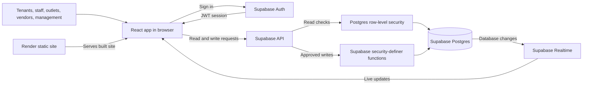

# Atluri Ascend - Smart Building Demo App

Live demo: https://ascend-demo-u3pg.onrender.com/

A working demo of one shared building system with five role-based portals (tenant, staff, outlet, vendor, management) plus a public QR pass page. Built for an assessment.

**Core idea: same engine, different configuration.** One request engine, one pass engine, one booking engine and one audit trail serve every flow. Roles are rows of data, not separate apps.

## Stack
**Frontend:** React builds the role-based portals, Vite develops and bundles the app, and Tailwind CSS 3 styles the interface.

**Backend and data:** Supabase provides PostgreSQL, authentication, Realtime updates, and row-level security. Database changes go through security-definer functions.

**Hosting:** Render serves the built frontend as a static site. Supabase provides the backend services.

## Architecture and request flow

In short: Render serves the website, Supabase checks who is signed in and what they can access, Postgres stores the building data, and Realtime sends updates back to the browser.

## What is real in the demo
- Food and coffee ordering end to end (order, outlet accept with ETA, runner pass, delivery, rating, billing)
- Generic service requests across 46 categories: assign, re-route, vendor work order with permit and pass, rating
- Medical SOS (urgent request to medical plus a sibling to security)
- Parcel desk with locker and PIN, stock with automatic low-stock reorder, SLA escalation
- Parking with quota check, bay allocation, 15-minute entry QR, entry and exit scans, expiry release
- Visitors: pre-registered pass, walk-in approval, public pass page at /pass/<token>, gate scanner
- Bookings with overlap and capacity checks; event approval creates 5 linked tasks
- Device simulator (fire, lift, pump, power, network and more) turning events into requests
- Management: building floor view, analytics, billing with CSV export, audit log, roles matrix, compliance

## What is simulated or generic
- Devices (ANPR, lifts, BMS, fire panel, sensors) are simulated events, not hardware.
- QR scanning at the gate is by pasting a pass link or clicking Scan; no camera.
- Creche, valet, laundry batches, evacuation roll-call, lost and found, asset register, preventive maintenance and others reuse the generic request engine.
- Certificate rows other than IGBC Gold and ECBC (named in the sales deck) are sample data.

## Run locally
1. Supabase: turn off Confirm email, run supabase/00_all.sql in the SQL Editor.
2. Create .env with VITE_SUPABASE_URL and VITE_SUPABASE_ANON_KEY. Create .env.seed with SUPABASE_URL and SUPABASE_SERVICE_ROLE_KEY. Never commit either file.
3. npm install
4. npm run seed-users  (creates 61 demo logins and starter activity)
5. npm run dev  then open http://localhost:5173

Demo logins: code@ascend-demo.com with password Demo@1234, for example t2@ascend-demo.com. As admin (m1@ascend-demo.com) use User Portals to open any role.

## Security model
- Browsers never write tables directly. All writes go through security-definer functions.
- Reads are filtered by row-level security: admin sees all, staff see their team, outlets see their outlet, vendors see their work orders, tenants see their own (T1 sees the company).
- The anon key is public by design. The service-role key is used only by the local seed script and never goes on Render.

## Deploy on Render
Static site, build command npm install && npm run build, publish directory dist, rewrite /* to /index.html, environment variables VITE_SUPABASE_URL and VITE_SUPABASE_ANON_KEY. render.yaml in this repo does all of that.

## Known data notes
- Car bays: 228 from the floor-plan counts versus 222 in the sales deck. Stored as configurable inventory.
- Staff functions: 32 defined (S01 to S32) although the source mentions S1 to S37.